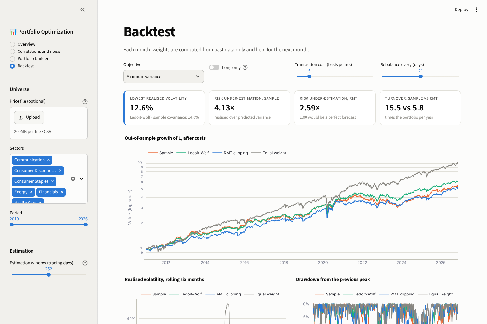
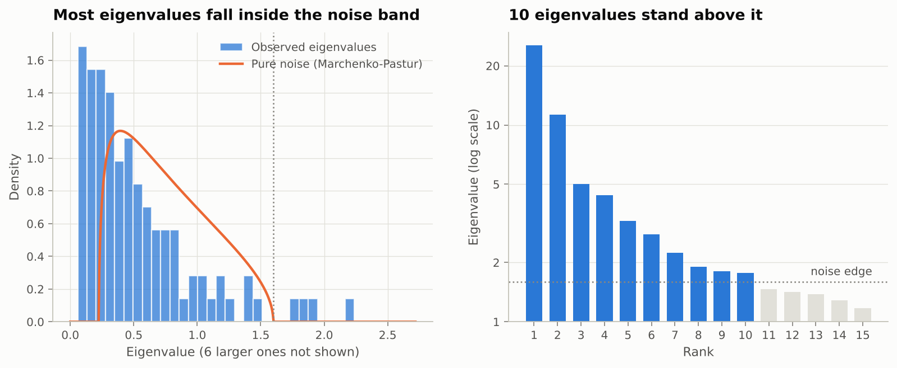
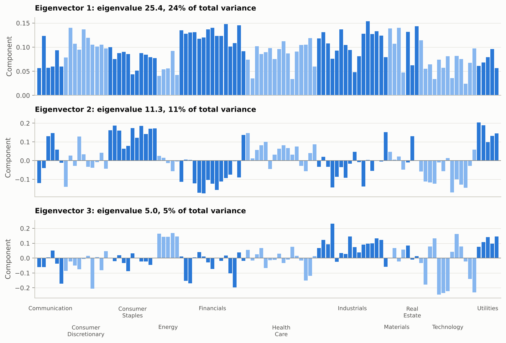
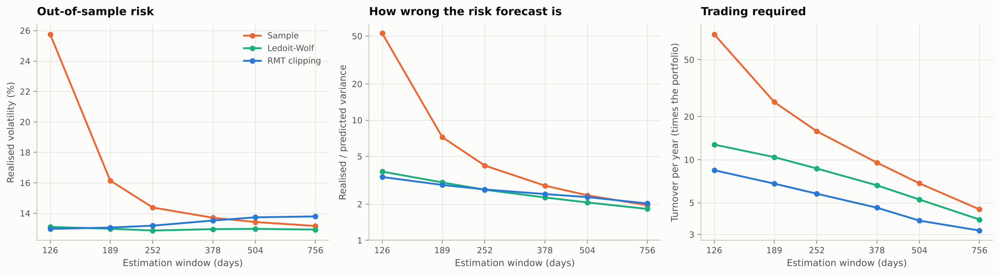
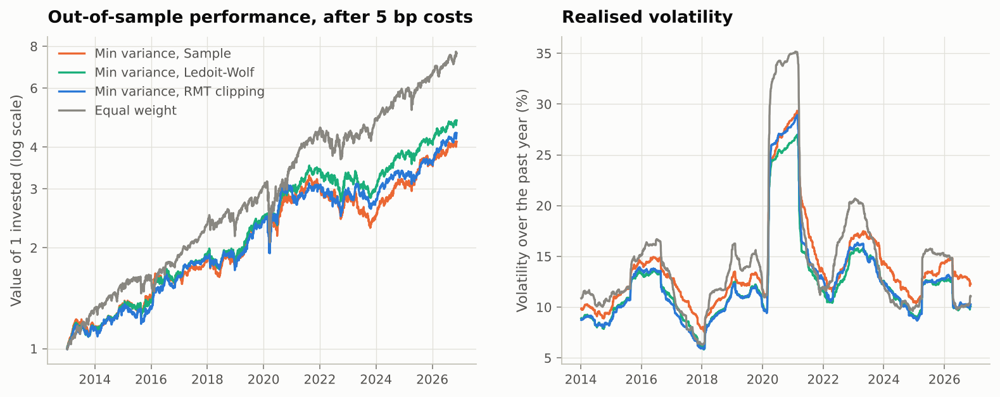
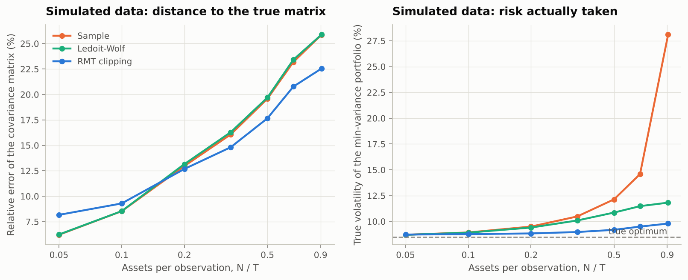

# Portfolio Optimization

How much of a correlation matrix is real, and what it costs to ignore the question.

Mean-variance optimisation needs a covariance matrix, and the one estimated from past returns is mostly noise when the number of assets is comparable to the number of observations. This project measures that noise with random matrix theory, removes it with two cleaning methods, and tests on 14 years of US stock returns whether the cleaned matrices produce better portfolios out of sample.



## Results

Data: daily returns of 104 large US stocks from January 2010 to November 2026 (Yahoo Finance). Portfolios are rebuilt every month from past returns only and evaluated on the following month, from January 2013, with 5 basis points of transaction costs.

### Most of the correlation matrix is noise

With 104 stocks and two years of data, only 10 of the 104 eigenvalues of the correlation matrix stand above the range that pure noise would produce (the Marchenko-Pastur law). They carry 58% of the variance. The largest, 24% of the variance alone, is the market.



The corresponding eigenvectors have an economic meaning. In the first, every stock has the same sign: it is the market. The second opposes defensive sectors (utilities, consumer staples, health care) to financials and technology.



### Cleaning helps when data is scarce and positions are unconstrained

Minimum-variance portfolio, long and short positions allowed, one year of data per estimate (N/T = 0.41):

| Covariance estimator | Realised volatility | Turnover per year | Realised / predicted variance | Max drawdown |
|---|---|---|---|---|
| Sample | 14.4% | 15.8x | 4.19 | -30.3% |
| Ledoit-Wolf shrinkage | 12.9% | 8.7x | 2.64 | -23.7% |
| RMT eigenvalue clipping | 13.2% | 5.8x | 2.65 | -22.3% |

The sample matrix gives the riskiest portfolio, trades almost three times more than the RMT version, and under-estimates the variance of its own portfolio by a factor of four.

The effect depends on the amount of data. With six months of data the sample portfolio is twice as risky as the cleaned ones; with three years the three are close.



| Estimation window | N/T | Sample | Ledoit-Wolf | RMT clipping |
|---|---|---|---|---|
| 126 days | 0.83 | 25.8% | 13.1% | 13.0% |
| 252 days | 0.41 | 14.4% | 12.9% | 13.2% |
| 504 days | 0.21 | 13.4% | 13.0% | 13.7% |
| 756 days | 0.14 | 13.2% | 12.9% | 13.8% |

*Realised volatility of the unconstrained minimum-variance portfolio.*

### Where cleaning does not help

- **With a lot of data.** From two years of data on, RMT clipping is slightly worse than the sample matrix (13.7% against 13.4%): once noise is small, averaging the small eigenvalues throws away real information. Ledoit-Wolf is the most robust of the three, at about 13% for every window.
- **With a long-only constraint.** All three estimators give 12.3% to 12.7% volatility, lower than any unconstrained version. Forbidding short positions already regularises the problem, as Jagannathan and Ma (2003) showed.
- **For the risk forecast.** Even cleaned estimators realise about 2.6 times the variance they predict. Cleaning removes sampling noise, not the fact that volatilities and correlations change over time.

### Returns: equal weight was hard to beat

| Strategy (one year of data, long only unless stated) | Annual return | Volatility | Sharpe ratio | Max drawdown |
|---|---|---|---|---|
| Minimum variance, Ledoit-Wolf, long-short | 12.0% | 12.9% | 0.95 | -23.7% |
| Minimum variance, sample | 10.6% | 12.3% | 0.88 | -23.8% |
| Risk parity, RMT clipping | 14.7% | 14.6% | 1.01 | -31.9% |
| Equal weight | 15.8% | 15.7% | 1.01 | -34.2% |
| S&P 500 (SPY) | 14.5% | 16.8% | 0.89 | -33.7% |

Minimum-variance portfolios did what they are built for: lower volatility and smaller drawdowns. But equal weight had the highest return and Sharpe ratio. Maximum-Sharpe portfolios using historical mean returns reached a Sharpe ratio of only 0.82, whatever the covariance estimator: mean returns are too noisy to optimise on (notebook 1).



### Check on simulated data, where the truth is known

On returns simulated from a factor model with a known covariance matrix, the true risk of each portfolio can be computed exactly. With 100 assets and 110 observations, the sample matrix predicts 2.5% volatility for its minimum-variance portfolio and actually delivers 28.1%. Ledoit-Wolf delivers 11.8% and RMT clipping 9.8%, for a true optimum of 8.5%.



## Dashboard

```bash
streamlit run app/streamlit_app.py
```

Four sections with interactive charts (hover, zoom, click a legend entry to hide a series):

- **Overview**: the universe, its performance and the scale of the estimation problem.
- **Correlations and noise**: eigenvalue spectrum against the Marchenko-Pastur law, eigenvectors by sector, correlation matrix before and after cleaning.
- **Portfolio builder**: objective, estimator and constraints, with the resulting positions, sector allocation and efficient frontier.
- **Backtest**: walk-forward test of the three estimators against equal weight.

The universe (sectors, period), the estimation window and all settings are adjustable, and another price file can be uploaded.


## Installation

```bash
git clone https://github.com/AminD/portfolio-optimization-reference.git
cd portfolio-optimization-reference
python -m venv .venv
.venv\Scripts\activate          # Windows
# source .venv/bin/activate     # macOS / Linux
pip install -r requirements.txt
```

## Usage

```python
from portfolio import load_prices, to_returns, split_benchmark, covariance, optimizer, rmt, run_backtest
from portfolio.backtest import min_variance_strategy, equal_weight_strategy

returns, benchmark = split_benchmark(to_returns(load_prices("data/prices.csv")))
window = returns.iloc[-252:]

# Three covariance estimators
sample = covariance.sample_covariance(window)
shrunk = covariance.ledoit_wolf(window)
cleaned = covariance.rmt_clipped(window)

# Portfolios
weights = optimizer.min_variance(cleaned, long_only=True)
parity = optimizer.risk_parity(cleaned)

# Walk-forward backtest
strategies = {name: min_variance_strategy(estimator, long_only=False) for name, estimator in covariance.ESTIMATORS.items()}
strategies["Equal weight"] = equal_weight_strategy()
result = run_backtest(returns, strategies, window=252, rebalance_every=21, cost_bps=5)
result.returns              # daily out-of-sample returns of each strategy
result.risk_underestimation # realised over predicted variance
```

```bash
python scripts/download_prices.py --output data/prices.csv   # optional: fresh prices
python scripts/make_figures.py                               # figures and tables of this README
pytest                                                       # 39 tests
```

## Project structure

```
portfolio/
  data.py          prices, returns, sectors, simulated factor model
  rmt.py           Marchenko-Pastur law, spectrum analysis, eigenvalue clipping
  covariance.py    sample, Ledoit-Wolf and RMT-cleaned estimators
  optimizer.py     minimum variance, mean-variance, maximum Sharpe, efficient frontier,
                   risk parity, Black-Litterman
  backtest.py      walk-forward backtest with costs, turnover and risk forecasts
  metrics.py       return, volatility, Sharpe ratio, drawdown
  plotting.py      shared chart styles
app/streamlit_app.py   interactive dashboard
notebooks/             three notebooks with the full analysis
scripts/               data download, figures
tests/                 test suite
data/prices.csv        daily adjusted prices
docs/theory.md         mathematical background
docs/results/          result tables behind the figures
```

## Notebooks

1. [Markowitz optimisation and its weak point](notebooks/01_markowitz_and_estimation_error.ipynb): efficient frontier in and out of sample, instability of the weights, Black-Litterman.
2. [Random matrix theory](notebooks/02_random_matrix_theory.ipynb): the Marchenko-Pastur law, the spectrum of real returns, eigenvectors, cleaning, validation on simulated data.
3. [Out-of-sample test](notebooks/03_backtest.ipynb): the three estimators across windows and constraints.

## How the code is validated

- The Marchenko-Pastur density integrates to one and matches the spectrum of simulated noise.
- The Ledoit-Wolf implementation matches scikit-learn to machine precision.
- Optimisers are checked against closed-form solutions and first-order conditions, and against random portfolios.
- Black-Litterman returns the reference portfolio when there are no views.
- The backtest is tested for look-ahead: changing future returns does not change earlier weights.
- On simulated data with a known covariance, the cleaned estimators are closer to the truth and take less risk.

## Limits

- **Survivorship bias.** The universe is made of companies that are large today and have a complete price history since 2010. Past winners are over-represented, which inflates every return in this project, the equal-weight one most of all. Comparisons of risk between estimators are much less affected.
- **One market, one period.** Fourteen years of US large caps, mostly a rising market.
- **Data source.** Yahoo Finance adjusted prices. One known error (Danaher's 2016 spin-off, shown as a 61% one-day gain) is corrected in `portfolio/data.py`; others may remain.
- **Costs.** A flat 5 basis points per trade, with no borrowing cost for short positions and no market impact. The long-short portfolios, with gross exposures of 300% to 560%, would be more expensive to run than shown.
- **Estimators.** Linear shrinkage and eigenvalue clipping are the two classic cleaners. Non-linear shrinkage (Ledoit-Wolf 2017, Bun-Bouchaud-Potters 2017) is the natural next step.

## References

- H. Markowitz, "Portfolio Selection", *Journal of Finance*, 1952.
- L. Laloux, P. Cizeau, J.-P. Bouchaud and M. Potters, "Noise Dressing of Financial Correlation Matrices", *Physical Review Letters*, 1999.
- O. Ledoit and M. Wolf, "A Well-Conditioned Estimator for Large-Dimensional Covariance Matrices", *Journal of Multivariate Analysis*, 2004.
- R. Jagannathan and T. Ma, "Risk Reduction in Large Portfolios: Why Imposing the Wrong Constraints Helps", *Journal of Finance*, 2003.
- V. DeMiguel, L. Garlappi and R. Uppal, "Optimal Versus Naive Diversification", *Review of Financial Studies*, 2009.
- F. Black and R. Litterman, "Global Portfolio Optimization", *Financial Analysts Journal*, 1992.
- J. Bun, J.-P. Bouchaud and M. Potters, "Cleaning Large Correlation Matrices: Tools from Random Matrix Theory", *Physics Reports*, 2017.
